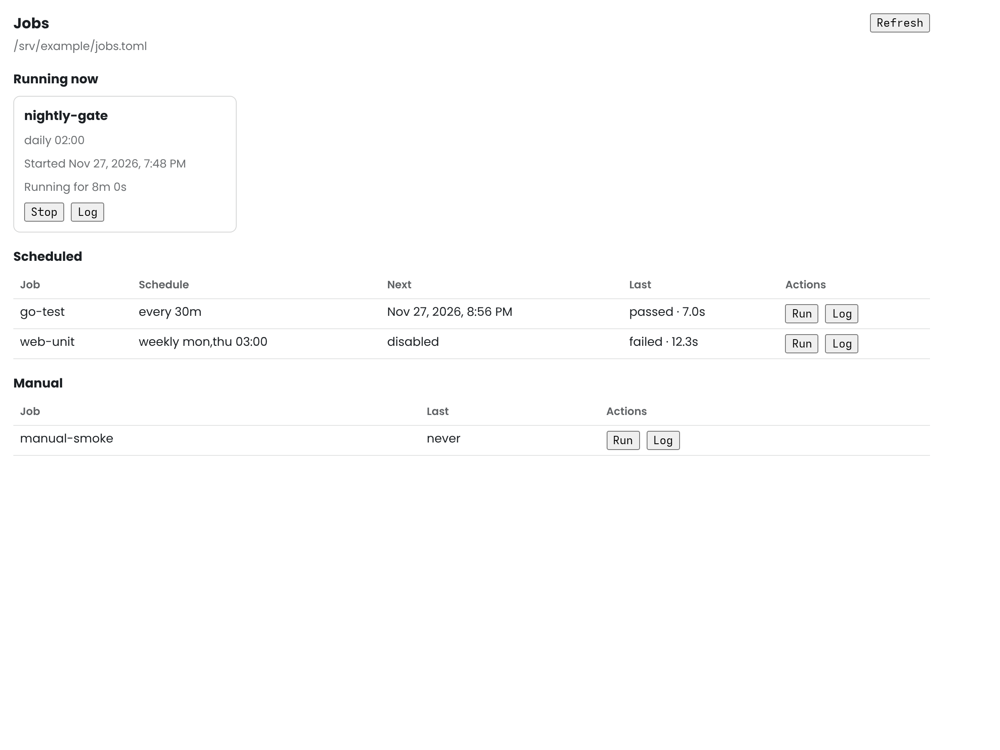

# Jobs

A PI WEB tab that shows the selected workspace's `jobctl` jobs: what is scheduled, what ran last, and what is
running now. **Run** starts a job, **Stop** ends a running job, and **Log** shows the tail of its output.



*The tab with sample data. The buttons use PI WEB's shared styles when the plugin runs in the host; this
preview renders the layout without them.*

## Why this tab

`jobctl` already keeps the schedule in the workspace's `jobs.toml` and the runs in its state directory. This
tab puts the two beside each other:

- **Scheduled** shows the jobs with a schedule, the next estimated run, and the last result.
- **Running now** shows the jobs whose latest receipt says `running`, with how long they have been running.
- **Run** and **Stop** go through `jobctl`, so a manual run takes the same locks, timeout, receipt and log as a
  scheduled one.
- **Log** reads the latest run's `output.log` without leaving the tab.

The tab is read-only about scheduling. It does not edit `jobs.toml`, install scheduler units, pause a schedule
or delete runs. Scheduling stays with systemd and launchd.

## Requirements

- PI WEB with browser API v5 and server API v5, including the `stylesheet-integration` v1 capability. It was
  checked on PI WEB `1.202611.4`. An older host skips the tab instead of rendering it unstyled.
- `jobctl` with the `stop` command. Put it on the session daemon's `PATH` or set `binary` below.
- A `jobs.toml` in the selected workspace.
- A session-daemon restart after installation, because the plugin has a server entry. A browser reload alone is
  not enough.

## Install

The package is not published yet. From a clone:

```bash
git clone https://github.com/ivolejon/pi-web-jobs.git
ln -sfn "$(pwd)/pi-web-jobs" ~/.pi-web/plugins/jobs
# When the daemon can restart:
# systemctl --user restart pi-web-sessiond
```

Then reload the browser and enable **Jobs** under **Settings → PI WEB plugins** if it is not enabled by
default. On a machine where `PI_WEB_DATA_DIR` is set, link into `$PI_WEB_DATA_DIR/plugins` instead.

Restarting the session daemon interrupts active sessions and terminals. Finish important work first.

When the package is published, the same steps are:

```bash
pi install npm:pi-web-jobs
systemctl --user restart pi-web-sessiond
```

## Settings

The plugin reads machine-global settings. In the PI WEB configuration (`$PI_WEB_CONFIG`, or
`~/.config/pi-web/config.json`):

```json
{
  "plugins": {
    "jobs": {
      "enabled": true,
      "settings": {
        "binary": "/usr/local/bin/jobctl",
        "stateDir": "/root/.local/state/jobctl",
        "config": "jobs.toml"
      }
    }
  }
}
```

| Setting | Meaning | Default |
| --- | --- | --- |
| `binary` | The `jobctl` binary or its name | `$JOBCTL_BIN`, then `jobctl` |
| `stateDir` | The state directory `jobctl` uses | `$JOBCTL_STATE_DIR`, `$XDG_STATE_HOME/jobctl`, `~/.local/state/jobctl` |
| `config` | The config file, relative to each workspace | `jobs.toml` |

Restart the session daemon after a settings change.

## Behavior

| Section | Source |
| --- | --- |
| Scheduled | `jobctl list --json` for the workspace's config; `Next` is jobctl's own estimate |
| Running now | The newest receipt under `stateDir/runs/<job>/` whose `status` is `running` |
| Last | The newest receipt for the job |
| Log | The last 64 KiB of the newest run's `output.log` |

The tab refreshes every two seconds while it is open and when the workspace's files change.

**Run** runs `jobctl run NAME --trigger manual`. A busy lock, an invalid config or an unknown job is shown in the
tab; jobctl's own run receipt and log are the record.

**Stop** runs `jobctl stop NAME`. jobctl sends `SIGTERM` to the runner, which forwards it to the job's process
group, waits `kill_grace`, records the run as `interrupted` and exits 143. The tab returns as soon as the stop is
requested and the next refresh shows the final status. A job that is not running, or whose recorded runner is
gone, is reported instead of being signaled.

Disabled jobs can still be run manually, as in jobctl.

## Limits

- The receipt is the source of "running". A runner killed with `SIGKILL` can leave a stale `running` receipt;
  **Stop** refuses when the recorded runner is gone or its pid was reused (it compares the process start time).
- **Stop** needs a jobctl version with the `stop` command and a run that wrote its process record. Runs started
  by an older build cannot be stopped this way.
- `jobctl` state is machine-wide and keyed by job name. Use unique job names across workspaces.
- The tab does not change schedules, install units, or delete runs.

## Development

```bash
npm test
```

The tests use `node:test` and a fake `jobctl` binary. They cover the server's overview, run, stop and log
requests, the missing binary and old-version paths, the response validation, and the view helpers. No third-party
dependency is needed to run the plugin.

`test/panel.html` is a preview with sample data. Serve the repository and open it in a browser:

```bash
python3 -m http.server 8765
# http://127.0.0.1:8765/test/panel.html
```

The plugin has no build step. The browser entry is `browser/pi-web-plugin.js`; the server entry is
`server/plugin.js`. The package is limited to those two directories, the README and the license.

## License

[MIT](LICENSE).
